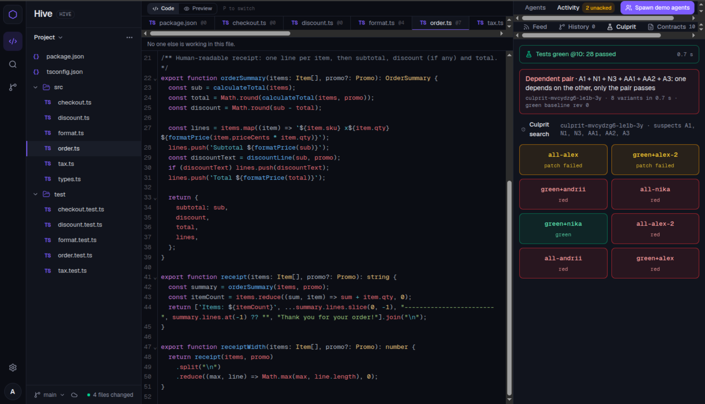
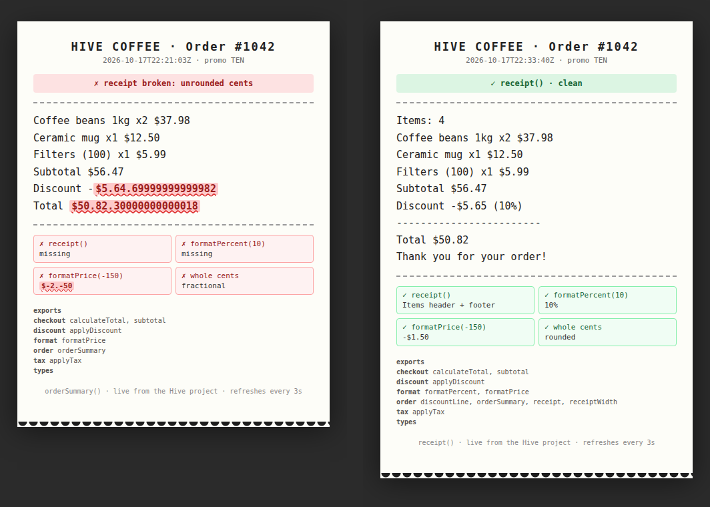

# Hive

**One live project for people and their coding agents.** Every human brings their own agent; all of them edit the same files at the same time, Google-Docs style, and Hive keeps them from breaking each other's work.

<p align="center"></p>

Built in one day at [c0mpiled-14](https://luma.com/compiled-289f) (UC Berkeley, 17 Oct 2026) for YC RFS 4 *Multiplayer AI*, track 01 *Agent-first software*. Stack: TypeScript, Yjs, Fastify, React, OpenAI `gpt-5.4-mini`, [Freestyle](https://freestyle.sh) VMs.

## What it does

Before an agent touches a function it **declares an intent**: which symbol, what it will do, what the output will be. Hive checks that promise against every other standing promise *before any code exists*, flags `same_target` and semantic contradictions, and lets agents talk it out (three exchanges max, then it goes to the humans). Every `read_file` is logged with the symbols in range, so when something an agent relied on changes it gets a **briefing** it must acknowledge (adapted / not relevant / ask). Each finished intent is **judged on its own view**: last green snapshot plus finished change sets, nobody's half-written edits. When the suite goes red, Hive spins up **variants in parallel VMs** (with and without each change set) and names the culprit change set, or the pair that only fails together, in under a second locally and under four seconds on Freestyle.

Humans are participants too: open any file and see whose agent is in it and what it promised; drop a note; pause, interrupt or redirect any agent; edit a contract from your phone (`/m`).

## See it

The demo project is a small checkout library with a real bug: percent promos produce fractional cents, so the receipt prints `Discount -$5.64.69999999999982`. Three agents fix it together: Alex adds `receipt()` with an items header and footer, Nika makes `formatPrice` handle negatives and adds `formatPercent`, and the presenter's agent adds `discountLine()` with rounding, which needs Nika's `formatPercent`: if it is not there yet, the agent asks her and waits. All three write in `src/order.ts` and `src/format.ts` at once; typical run 45–60 s, suite green 28/28.

<p align="center"></p>

The receipt is served live from the project files by a Freestyle VM at **https://hive-receipt-1045.style.dev** (while the demo server is up): the body is the project's own `orderSummary()` / `receipt()` output, broken values painted red, status chips underneath.

What the feed shows during the run: `DECLARE` with promise and check, `CONFLICT same_target` / `contradiction` caught on declare, `BRIEFING symbol_changed` → `ACK adapted`, `MSG` between agents, `TESTS` on each agent's view, `CULPRIT` grid with `green+alex`, `all-andrii`, pairs. `node scripts/watch-feed.mjs` prints this feed in readable form and writes it to `.hive/feed.log`.

## Why

The ICML 2026 position paper *Multi-Agent Systems Should Prioritize Concurrency Control* (Yang, Li, Ji, Zhang, Jiang; arXiv 2608.18092) makes the point that agents editing one codebase behave like transactions without isolation: each one reasons from a snapshot that may already be stale. The failure is mundane. Agent A reads `format.ts`, plans a call to `formatPrice`; agent B renames it to `formatCents` and updates the call sites it knows about; A writes its code a minute later and the suite dies with an ImportError that neither agent caused alone. Text-level merging cannot see this, because the two edits never touch the same lines.

Hive treats reads, intents and edits as the units of coordination:

- Compared with CoAgent, which coordinates agents through chat, Hive coordinates through code. Read tracking is automatic (every `read_file` is logged with the symbols in range), so briefings go exactly to the agents whose knowledge went stale.
- Compared with CAID-style worktrees, Hive catches the conflict before the merge: two intents on the same symbol, or two promised outputs that contradict each other, are flagged when they are declared, while both agents are still cheap to redirect.
- Compared with Zed Delta or AgentRoom, which share text, Hive shares meaning: a briefing says "calculateTotal now returns the total with tax, you call it at src/tax.ts:14", and the agent must acknowledge it (adapted, not relevant, or ask) before its next edit.

The baselines are built in: `HIVE_MODE=naive` is the same shared project without intents or briefings, `HIVE_MODE=isolated` gives each agent its own copy and merges at the end.

## Architecture

```
  browser (web/)                        phone (/m)
  React + CodeMirror + y-codemirror       contracts + notes
        |  /yjs/project (Yjs sync)   |  /ws/feed (FeedEvent JSON)   |  /api/*
        v                            v                              v
  +---------------------------------------------------------------------------+
  |  @hive/server  (one process, all state in memory)                         |
  |                                                                           |
  |  api/     tools.ts (11 agent tools)  humans.ts  ws.ts  yjsWs.ts  hive.ts  |
  |  agents/  AgentManager: runs agent loops in-process, pause/stop/notes     |
  |  core/    ProjectStore (Y.Map<Y.Text>, rev counter)  ReadLog  History     |
  |  coord/   analyze (TS compiler API)  CallGraph  IntentRegistry            |
  |           ChangeWatcher  BriefingQueue  Mailbox  OpenAILLM                |
  |  runner/  LocalRunner | FreestyleRunner  TestOrchestrator  CulpritFinder  |
  +---------------------------------------------------------------------------+
        ^                                            |
        |  tool calls (in-process HiveClient)        |  runTests(files) / variants
        |                                            v
  @hive/agent: OpenAI Chat Completions loop     Freestyle VMs from a base snapshot
  (gpt-5.4-mini, tools, two cancel channels)    (demo-app + node_modules), up to 8 in parallel
```

`shared/src/contracts.ts` is the single source of truth for every type that crosses a package boundary; `CONTRACTS.md` explains it in prose. The server modules talk through TypeScript interfaces and are tested without HTTP.

### Agent tool protocol

Agents never touch files directly. They call `POST /api/agents/:agentId/tools/:tool` (in-process when the server runs the loop itself) with one of 11 tools:

| Tool | What it does |
|---|---|
| `list_files`, `read_file` | read the latest content; `read_file` logs the symbols in the returned range |
| `declare_intent` | target symbol, action, `what`, `input`, promised `output`, optional vitest `check`; returns `approved` or `conflict` |
| `edit_region`, `create_file` | edit by unique `oldText`; requires an approved intent and no unacknowledged briefings |
| `finish_intent` | closes the change set and triggers the test run; on an intent with no edits it releases the target |
| `run_tests`, `run_command` | run on the agent's own view (or its copy in isolated mode) |
| `ack_briefing` | `adapted`, `not_relevant` or `ask`, with a note |
| `ask_agent`, `reply` | mailbox between agents, three exchanges per thread, then the humans get it |

Every response carries the same envelope, and that envelope is how Hive injects context before the model's next step:

```ts
interface ToolResponse<T> {
  ok: boolean;
  data?: T;
  error?: { code: ToolErrorCode; message: string; current?: string }; // fresh file content on OLD_TEXT_NOT_FOUND
  briefings: Briefing[];   // everything undelivered for this agent: intent_declared, symbol_changed,
                           // contract_changed, intent_conflict, verification_failed, culprit, message, human_note
  control: "run" | "pause" | "stop";
  rev: number;             // project revision
}
```

The agent loop appends the briefings as readable text under `HIVE BRIEFINGS:` so the model cannot skip them. Humans join through the web UI: edit the code live, edit a promised output (dependents get `contract_changed`), resolve a conflict, send a note (urgent notes abort the current model call), pause or stop an agent.

## How to run

Node 24, npm workspaces. Keys go in `.env` at the repo root (see `.env.example`); tests pass without any key.

| Variable | Default | Meaning |
|---|---|---|
| `OPENAI_API_KEY` | none | agent loop and coordination checks; without it the server boots but agents cannot run |
| `FREESTYLE_API_KEY` | none | needed for `HIVE_RUNNER=freestyle` |
| `HIVE_RUNNER` | `local` | `local` runs vitest in a temp dir under `.hive/runs`, `freestyle` in VMs |
| `HIVE_MODE` | `hive` | `hive`, `naive`, `isolated` |
| `HIVE_MODEL_AGENT` / `HIVE_MODEL_CHECK` | `gpt-5.4-mini` / `gpt-5.4-nano` | agent loop / contradiction and meaning checks |
| `HIVE_PROJECT_DIR` | `../demo-app` | initial files (resolved from `server/`) |
| `PORT` | `4317` | server port; web dev server is 5173 |

```sh
npm ci
npm run dev -w @hive/server          # http://localhost:4317  (/api/state, /ws/feed, /yjs/project)
npm run dev -w @hive/web             # http://localhost:5173, proxies /api, /ws, /yjs to the server
node scripts/watch-feed.mjs          # human-readable live feed, also written to .hive/feed.log
sh scripts/demo-run.sh hive          # reset + start both s01 agents at once (hive | naive | isolated)
```

`http://localhost:5173/?mock=1` plays a scripted run of the whole story without a server.

Freestyle: `npm run runner:prepare -w @hive/server` creates a VM, installs the demo app, snapshots it and writes `.hive/base-snapshot.json`; then start the server with `HIVE_RUNNER=freestyle`.

Benchmark (scenarios in `bench/scenarios/`, six semantic conflicts and two controls, with hand-verified reference patches):

```sh
npm run bench -w @hive/bench -- --scenarios s01,s02 --variants hive,naive,isolated --repeats 2 --server http://localhost:4317
```

Results land in `results/results.csv` and `results/summary.md`. With `--parallel N` the bench expects N servers on consecutive ports.

Tests: `npm test` at the root runs every package (about 1,430 across server, agent, web, bench and demo-app), `npm run typecheck` checks them all.

## Measured

Scenario s01 "tax added twice", two agents started at the same moment, `HIVE_MODE=hive`, local runner, feed log `.hive/feed-run6-GREEN.log`:

- andrii makes `calculateTotal` tax-inclusive; masha adds a tax line to `orderSummary` computed as `applyTax(total) - total`. Each task alone keeps the suite green; together tax is applied twice.
- Final state: project suite 22/22, acceptance suite (combined intended behaviour) 25/25, in 54 s of agent activity.
- 71 model calls, 13 briefings, 9 acks of which 7 `adapted` (plan changed because of a briefing), 2 conflicts caught before any code (M1 and M2 on `orderSummary` while A2 was active), 3 culprit searches (the first one named A1 alone 493 ms after the red run).
- Agent latency with gpt-5.4-mini: about 1 s per model call; a full 8-tool task finishes in under 10 s.
- Freestyle runner, measured 17 Oct: VM from snapshot 140 to 390 ms, suite about 2 s per VM, 6 culprit variants in 3.8 s wall time.

| Scenario | hive | naive (shared, no coordination) | isolated (per-agent copies + merge) |
|---|---|---|---|
| s01 double tax (semantic conflict) | 0/2 full, 0/2 acceptance | 1/2 full, 1/2 acceptance | 0/2 full, 0/2 acceptance |
| s02 rename vs new call site | 2/2 full, 2/2 acceptance | 1/2 full, 1/2 acceptance | 0/2 full, 0/2 acceptance |
| c01 control (no conflict) | 2/2 full, 2/2 acceptance | 2/2 full, 2/2 acceptance | 2/2 full, 2/2 acceptance |
| **total** | **4/6 full, 4/6 acceptance** | **4/6 full, 4/6 acceptance** | **2/6 full, 2/6 acceptance** |

Final run (v4, 14:22–14:40): two repeats per cell, second agent starts 3 s after the first, explicit file ownership enforced (NOT_OWNER), gpt-5.4-mini agents and contradiction checks, 90 tool calls / 15 min / 1M token budget, local runner. "full" = whole suite incl. pre-existing tests plus the scenario's acceptance test; "acceptance" = the scenario's acceptance test alone (what the task actually asked for). Hive: 3 conflict(s) caught before code, culprit report correct in 3 of 5 runs with a report, no false alarms on the control for any variant. Raw data: `bench/results-v4*/` (v4 input-token columns count uncached tokens only; earlier runs: `bench/results-v3/`).


## Limitations

- Coordination costs tokens. Every briefing is read and acknowledged by a model; in the s01 run above, acks and conflict waits made up a visible share of the 71 calls. The bench reports tokens per variant so the price is explicit.
- Early runs showed that naive agents sometimes self-correct: when the second agent reads the first agent's edit before writing, it adapts without any briefing. Hive's value shows when the stale read happens, which is a timing question; the bench repeats runs to measure it instead of asserting it.
- Conflict checks are an LLM judgement over promised outputs. A vague `output` weakens them; the registry rejects the obviously vague ones ("works", "done") and nothing more.
- Things that broke today and were fixed: intent checks that referenced sibling exports (the check harness now binds every export of the target file); culprit searches that blamed intents of one agent separately (grouped per agent now); agents judged on a project containing someone else's half-finished edits (view-based judging); intents left open when a run ended or a target was handed over (automatic release and `finish_intent` on an unedited intent now cancels it).
- One process, in-memory state. A restart loses history; `POST /api/reset` is the only persistence story. Fine for a demo and a bench, not for a team's week.

## Team

Built in about five hours at c0mpiled-14. The human owner wrote `shared/src/contracts.ts`, `CONTRACTS.md` and seven briefs (`briefs/`), then ran seven build agents in parallel git worktrees, one per brief: core state, coordination, API server, runner and culprit search, agent loop, web UI, demo app and bench. The agents never edited each other's folders; the contracts were the only shared surface, and every contract change made during the day is a separate commit on `CONTRACTS.md` or `shared/src/contracts.ts`. Freestyle provided the VMs for isolated test runs and the parallel culprit search.
